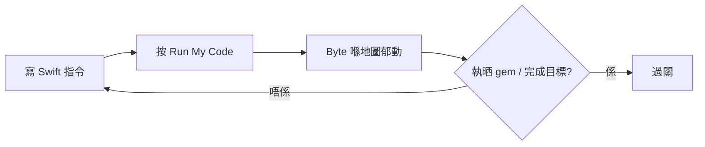
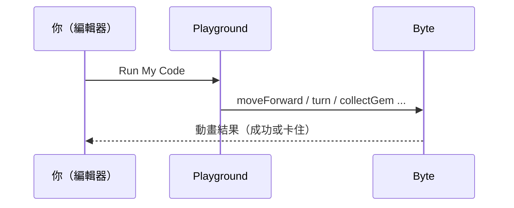

# Swift Playground · Learn to Code 指南

> **語言** · [粵語／繁中（本頁）](#) · [English](en/README.md)

原創教學筆記：點樣喺 Mac 裝 **Swift Playground**、打開 **Learn to Code 1**、理解畫面，同用 Byte 嘅基本指令解「執寶石」（Collect Gems）類關卡。

**本 repo 唔包含任何 Apple 嘅 `.playgroundbook`／教材 zip／課文原文。** Apple 內容請用官方 App 或 Apple CDN 自己下載（見 [docs/CDN-MANIFEST.md](docs/CDN-MANIFEST.md)）。

---

## 目錄

1. [Swift Playground 係咩](#1-swift-playground-係咩)
2. [點樣喺 Mac 安裝](#2-點樣喺-mac-安裝)
3. [打開 Learn to Code 1](#3-打開-learn-to-code-1)
4. [畫面點睇](#4-畫面點睇)
5. [基本指令（primitives）](#5-基本指令primitives)
6. [Collect Gems 類關卡點玩](#6-collect-gems-類關卡點玩)
7. [之後會學到咩（概覽）](#7-之後會學到咩概覽)
8. [官方連結](#8-官方連結)
9. [授權](#9-授權)

---

## 1. Swift Playground 係咩

**Swift Playground**（App Store 名多數係單數 *Playground*；舊名／行銷常寫 *Playgrounds*）係 Apple 嘅程式學習 App。你可以：

- 跟官方互動書（例如 Learn to Code）喺 3D 世界指揮角色
- 用 Blank／App Playground 寫自己嘅 Swift／SwiftUI

本指南聚焦 **Learn to Code 1** 入面嘅執寶石風格謎題。



---

## 2. 點樣喺 Mac 安裝

1. 開 **App Store**，搜尋 **Swift Playground**（出版社：Apple）。
2. 安裝後路徑通常係：`/Applications/Swift Playground.app`。
3. （可選）命令列：`mas search "Swift Playground"` → `mas install <id>`。

系統要求以 App Store 頁為準（較新 macOS）。

---

## 3. 打開 Learn to Code 1

1. 開 Swift Playground。
2. 喺 **Get Started**／圖庫撳 **Learn to Code 1** 下載（第一次要等下載完成）。
3. 打開之後會見到一連串關卡；早期關卡就係教你行路、轉彎、執寶石。

> **小提示：** 圖庫入面通常 **冇** 一個獨立名叫「Collect Gems」嘅項目。「執寶石」係 Learn to Code 1 **入面** 嘅關卡風格，唔係另外一本 gallery book。

用 Finder 開本地書（若你已從 CDN 下載）：雙擊 `Learn to Code 1.playgroundbook`，或者用：

```bash
open -a "Swift Playground" "/path/to/Learn to Code 1.playgroundbook"
```

---

## 4. 畫面點睇

典型編排：

| 區域 | 作用 |
|------|------|
| **左邊** | 程式編輯器——你寫／改 Swift 指令 |
| **右邊** | 立體世界——Byte、格子、寶石、開關 |
| **Run My Code**（或 ⌘R） | 由上到下執行你嘅指令 |
| 提示／說明 | 官方課文（本 repo 唔轉載） |

執行順序好重要：指令係 **順序** 跑嘅，唔係同時。

---

## 5. 基本指令（primitives）

Learn to Code 早期關卡最常用呢幾個（名稱同語意以書入面 API 為準；以下係**原創**迷你例子，唔係抄課文）：

| 指令 | 意思 |
|------|------|
| `moveForward()` | 向前行一格 |
| `turnLeft()` | 原地左轉 90° |
| `turnRight()` | 原地右轉 90°（有啲早期關未必開放；可用三次 `turnLeft()` 代替） |
| `collectGem()` | 企喺有寶石嘅格先 call，執起 gem |
| `toggleSwitch()` | 企喺開關格先 call，切換開關 |

### 例 A — 直行三格再執寶石（原創示意）

```swift
moveForward()
moveForward()
moveForward()
collectGem()
```

### 例 B — 轉彎再執（原創示意）

```swift
moveForward()
turnLeft()
moveForward()
collectGem()
```

### 例 C — 未有 `turnRight` 時用三次左轉（原創示意）

```swift
moveForward()
turnLeft()
turnLeft()
turnLeft()  // 等同向右轉
moveForward()
collectGem()
```

### 常見錯法

- 未企喺寶石格就 `collectGem()` → 執唔到
- 轉彎次數錯 → Byte 撞牆或行錯方向
- 以為可以「跳格」→ 多數關卡一行只郁一格

---

## 6. Collect Gems 類關卡點玩

目標通常係：指揮 Byte **行完整條路徑**，喺正確格子 `collectGem()`（有時仲要 `toggleSwitch()`），令所有目標完成。

建議思考步驟：

1. **睇地圖**：Byte 初始面向邊、寶石喺邊、有冇牆。
2. **心算路徑**：用格數數清楚「行幾多、轉幾多」。
3. **寫最短清楚嘅指令序列**，Run 一次睇結果。
4. **錯就改**：唔好一次加好多行；一次改一個轉彎最易 debug。



---

## 7. 之後會學到咩（概覽）

用自己嘅話概括（唔抄官方章節名細節）：

| 概念 | 點解有用 |
|------|----------|
| **`for` 迴圈** | 同一組 `moveForward()` 重覆好多次時，唔使抄十行 |
| **函式 `func`** | 將「行兩格再左轉」包成一個名，關卡之間重用 |
| **條件／`while`** | 跟住探測（例如前面係咪空）決定行定轉 |
| **Learn to Code 2** | 更複雜地圖同演算法思維 |
| **Get Started with Apps** 等 | 轉去 SwiftUI App 範例（`.swiftpm`） |

學完 primitives 之後，重點係 **拆問題**：重複嘅動作 → 迴圈；重複嘅模式 → 函式。

---

## 8. 官方連結

- [Swift Playground · Mac App Store](https://apps.apple.com/app/swift-playground/id1496833156)
- [Get started with Swift Playgrounds（Apple Support）](https://support.apple.com/guide/playgrounds/welcome/mac)
- CDN feed index：`https://playgrounds-cdn.apple.com/feedIndex.json`
- 本指南對應 App 約 **4.7** 時常用 feed：`7A53`（見 index 入面 `v4.6` → `7A53`）
- **自行下載清單（只有 URL）**：[docs/CDN-MANIFEST.md](docs/CDN-MANIFEST.md)

---

## 9. 授權

- 本 repo **教程文字／原創 snippet／圖**：見 [LICENSE](LICENSE)（MIT）。
- **Apple 教材、美術、playgroundbook、CDN zip**：版權屬 Apple；**唔會**放喺呢個 GitHub repo。請合法經 App 或 Apple CDN 取得。

---

## 相關 repo

如果你想學「空白 Playground 寫 Swift／SwiftUI」另一條路，可睇：[`wing-kit/swift-playgrounds-course`](https://github.com/wing-kit/swift-playgrounds-course)（同樣係原創教材，唔等同 Learn to Code 關卡書）。
