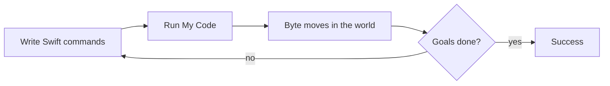

# Swift Playground · Learn to Code Guide

> **Languages** · [Cantonese / Traditional Chinese](../README.md) · [English (this page)](#)

Original notes on installing **Swift Playground** on Mac, opening **Learn to Code 1**, reading the UI, and using Byte’s primitive commands for Collect Gems–style puzzles.

**This repository does not ship Apple `.playgroundbook` packages, lesson zips, or verbatim Apple lesson text.** Download Apple content yourself via the app or Apple’s CDN ([docs/CDN-MANIFEST.md](../docs/CDN-MANIFEST.md)).

---

## Contents

1. [What is Swift Playground?](#1-what-is-swift-playground)
2. [Install on Mac](#2-install-on-mac)
3. [Open Learn to Code 1](#3-open-learn-to-code-1)
4. [How the UI works](#4-how-the-ui-works)
5. [Primitive commands](#5-primitive-commands)
6. [Collect Gems–style play](#6-collect-gemsstyle-play)
7. [Later concepts (overview)](#7-later-concepts-overview)
8. [Official links](#8-official-links)
9. [License](#9-license)

---

## 1. What is Swift Playground?

**Swift Playground** (App Store name is often singular; marketing also says *Playgrounds*) is Apple’s learning app for Swift. You can follow interactive books such as Learn to Code, or start Blank / App playgrounds.

This guide focuses on gem-collecting puzzles inside **Learn to Code 1**.



---

## 2. Install on Mac

1. Open the **App Store** and search for **Swift Playground** (Apple).
2. After install: `/Applications/Swift Playground.app`.
3. Optional CLI: `mas install` after looking up the app id.

Check the App Store page for macOS requirements.

---

## 3. Open Learn to Code 1

1. Launch Swift Playground.
2. Download **Learn to Code 1** from Get Started / the gallery.
3. Early levels teach moving, turning, and collecting gems.

> There is usually **no** standalone gallery item named “Collect Gems”. That style of puzzle lives **inside** Learn to Code 1.

```bash
open -a "Swift Playground" "/path/to/Learn to Code 1.playgroundbook"
```

---

## 4. How the UI works

| Area | Role |
|------|------|
| **Left** | Code editor |
| **Right** | 3D world (Byte, tiles, gems, switches) |
| **Run My Code** (⌘R) | Runs your commands top to bottom |
| Tips / lesson copy | Official Apple text (not reproduced here) |

Order matters: commands run **sequentially**.

---

## 5. Primitive commands

Common early APIs (confirm names in the book; examples below are **original** illustrations):

| Call | Meaning |
|------|---------|
| `moveForward()` | Move one tile forward |
| `turnLeft()` | Turn 90° left in place |
| `turnRight()` | Turn 90° right (sometimes unlocks later; three `turnLeft()` ≈ one right) |
| `collectGem()` | Pick up a gem on the current tile |
| `toggleSwitch()` | Toggle a switch on the current tile |

### Example A — three steps, then collect

```swift
moveForward()
moveForward()
moveForward()
collectGem()
```

### Example B — turn, then collect

```swift
moveForward()
turnLeft()
moveForward()
collectGem()
```

### Example C — right turn via three lefts

```swift
moveForward()
turnLeft()
turnLeft()
turnLeft()
moveForward()
collectGem()
```

### Common mistakes

- Calling `collectGem()` off a gem tile
- Wrong turn count → wrong facing / walls
- Expecting multi-tile jumps in early levels

---

## 6. Collect Gems–style play

Typical goal: walk a path, `collectGem()` (and sometimes `toggleSwitch()`) on the right tiles until every objective is done.

1. Read the map (facing, gems, walls).
2. Count tiles and turns.
3. Write a clear sequence; Run once.
4. Fix one mistake at a time.

---

## 7. Later concepts (overview)

| Idea | Why it helps |
|------|----------------|
| `for` loops | Avoid copy-pasting the same moves |
| `func` | Name reusable patterns |
| Conditionals / `while` | React to sensors / open paths |
| Learn to Code 2 | Harder maps and algorithms |
| Get Started with Apps, etc. | Move into SwiftUI `.swiftpm` samples |

After primitives, practice **decomposition**: repetition → loops; patterns → functions.

---

## 8. Official links

- [Swift Playground on the Mac App Store](https://apps.apple.com/app/swift-playground/id1496833156)
- [Apple Support — Swift Playgrounds](https://support.apple.com/guide/playgrounds/welcome/mac)
- Feed index: `https://playgrounds-cdn.apple.com/feedIndex.json`
- Feed used with app ~4.7: `7A53` (see `v4.6` in the index)
- URL-only catalog: [docs/CDN-MANIFEST.md](../docs/CDN-MANIFEST.md)

---

## 9. License

- Tutorial text / original snippets / diagrams: [LICENSE](../LICENSE) (MIT).
- Apple books, art, and CDN binaries: © Apple; **not** redistributed here.
